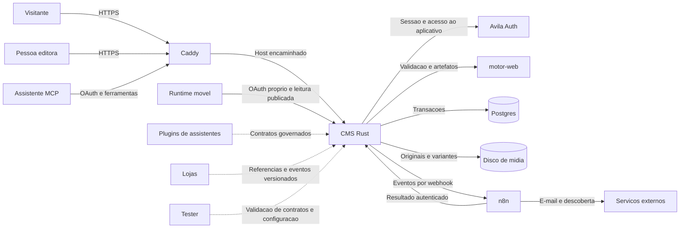
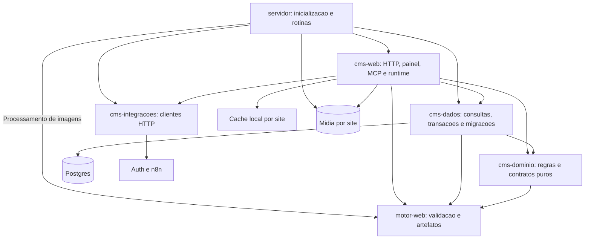
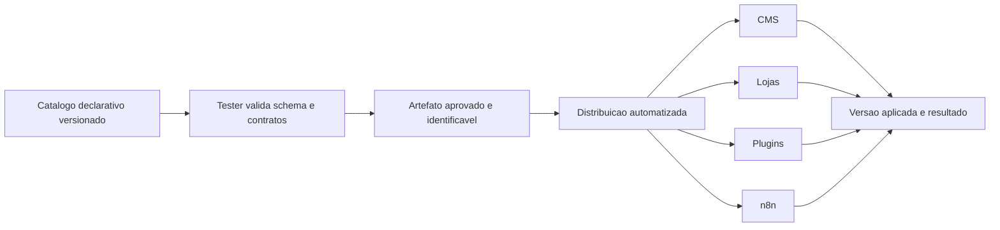

# Arquitetura do CMS Ávila Ops

Este documento descreve o código disponível no repositório em 25/10/2026.
**Atual** significa implementação identificada nas fontes; não confirma
implantação, credenciais configuradas ou operação em produção. **Alvo** designa
decisões de evolução ainda dependentes de implementação e verificação.

A referência de escopo é a
[spec de arquitetura e roadmap](superpowers/specs/2026-10-25-cms-arquitetura-roadmap-design.md).

## Contexto e limites

O CMS é a fonte de verdade de sites institucionais e conteúdo editorial:
identidade, páginas, posts, catálogo de apresentação, mídia e publicação.
Uma aplicação Rust atende vários sites pelo host e oferece um painel separado
por host, além de um conector MCP para assistentes.

O Lojas mantém o domínio transacional: catálogo comercial, carrinho, checkout,
pedidos, estoque e pagamentos. O `item` do CMS é conteúdo de apresentação;
`cms-dominio::fluxo::caminho_de` recusa `Conteudo::Produto`, e o fluxo de dados
não o aceita como documento do CMS. A fronteira não implica sincronização
automática com o Lojas.

O App Builder também está neste processo, mas tem contrato AAD, projetos,
participantes e versões próprios. Não transforma o `motor-web` em runtime
móvel nem torna as regras de apps equivalentes às regras editoriais.

### Contexto atual e relações-alvo

Linhas contínuas representam caminhos encontrados neste checkout. Linhas
pontilhadas representam contratos-alvo, sem alegação de integração entregue.

## Componentes internos

O [workspace Cargo](../Cargo.toml) contém cinco crates. O binário `servidor`
compõe o processo; Axum atende HTTP, SQLx acessa Postgres e Askama renderiza
templates. O [Dockerfile](../Dockerfile) empacota o binário e o volume de mídia;
não instala Node no runtime de produção.

O diagrama mostra responsabilidades e chamadas relevantes, não a totalidade
das dependências Cargo. `cms-dominio` não acessa banco ou rede.
`cms-dados::fluxo` coordena a transação e aplica as regras do domínio e do motor.
`cms-integracoes` encapsula comunicação externa, sem persistência.

### Responsabilidades e fontes de verdade

| Componente | Responsabilidade | Fonte de verdade e limite |
| --- | --- | --- |
| CMS editorial | Sites, documentos, mídia e publicação | Postgres do CMS; arquivos de mídia no volume do CMS |
| `cms-dominio` | Papéis, transições, endereços e contratos AAD | Tipos e regras Rust; sem armazenamento próprio |
| `cms-dados` | Isolamento das consultas e consistência transacional | Migrações SQLx e tabelas do CMS |
| `cms-web` | Entrada HTTP, renderização, painel e MCP | Adapta entradas; não substitui a validação compartilhada |
| `servidor` | Configuração, inicialização e trabalho periódico | Ambiente do processo e estado persistido das rotinas |
| `motor-web` | Validação, SEO, descoberta e processamento de imagens | Biblioteca fixada por revisão no workspace; não é banco de conteúdo |
| Auth | Identidade e autorização de entrada no aplicativo | Sessão consultada no Auth; participação no site continua no CMS |
| App Registry | Rascunhos AAD, snapshots e ambientes | Tabelas próprias de apps, separadas de documentos editoriais |
| Lojas | Comércio transacional | Domínio do Lojas; sem escrita direta no banco pelo CMS |
| n8n | Efeitos posteriores e comunicação com terceiros | Workflow versionado; resultado associado ao evento no CMS |
| Plugins | Interface de assistentes para contratos autorizados | Alvo: manifestos versionados, sem regras de negócio duplicadas |
| Tester | Evidências de compatibilidade e regressão | Alvo: validação do catálogo e contratos; não é dono do conteúdo |

## Modelo multi-tenant e resolução por host

O tenant editorial é o `site`, identificado por UUID. `participacao` liga o
`sub` da conta ao site e ao papel. Documentos, mídia, domínios e eventos se
relacionam ao site; versões pertencem ao documento. O isolamento depende das
consultas e da autorização da aplicação, não de uma base separada por site.

O [despacho HTTP](../crates/web/src/lib.rs) distingue o host do painel dos
hosts públicos. As rotas globais de saúde, autorização de domínio e retorno
de eventos são registradas antes desse despacho. O leitor de host prioriza
`X-Forwarded-Host` e depois `Host`, normaliza e valida o nome.

Um único rótulo antes do domínio-base resolve pelo slug do site. Outros hosts
resolvem como domínio próprio ativo. O esquema limita a um domínio ativo por
site. Host desconhecido recebe `404`; site suspenso recebe `410`. Quando há
domínio próprio ativo, o endereço provisório redireciona para ele.

As [rotinas](../crates/servidor/src/rotinas.rs) verificam os endereços DNS dos
domínios pendentes contra os IPs configurados. O Caddy consulta
`GET /api/dominio-permitido` para decidir sobre TLS sob demanda. Essa consulta
não substitui a resolução de conteúdo nem a autorização editorial.

O proxy é um limite de confiança: deve controlar os cabeçalhos encaminhados e
o acesso à origem. O parser valida a forma do host; isso não autentica quem
enviou `X-Forwarded-Host`.

Fontes: [endereços](../crates/dominio/src/endereco.rs),
[leitura pública](../crates/web/src/publico.rs) e
[migrações](../crates/dados/migrations/).

## Fluxos principais

### Leitura pública atual

1. O despacho identifica o host público. Um GET elegível pode usar o cache
   local por host, caminho, consulta e preferência por Markdown.
2. Sem resposta em cache, o CMS resolve o site, verifica suspensão e
   redirecionamentos, e consulta documentos publicados daquele site.
3. O motor fornece artefatos de SEO e descoberta; templates do CMS montam a
   apresentação. O visitante não recebe a versão em edição.
4. Respostas elegíveis com status `200` são guardadas associadas ao site.
   Mídia e arquivos próprios seguem seus handlers específicos.

Além de páginas e posts, o código oferece listagens de blog, categorias,
autores e `/produtos`, sitemaps, `robots.txt`, `llms.txt` e `llms-full.txt`.
A [negociação de Markdown](../crates/web/src/descoberta.rs) exige preferência
explícita em `Accept`; a resposta HTML continua disponível ao navegador.

### Edição e publicação atuais

1. Painel e MCP identificam a conta, resolvem sua participação no site e
   montam o ator. No MCP também se exige o escopo da ferramenta.
2. As ações editoriais chamam [o fluxo compartilhado](../crates/dados/src/fluxo.rs).
   A transação trava o documento do site e verifica a permissão.
3. Salvar mantém um rascunho e devolve problemas de validação. Enviar para
   revisão registra a solicitação; isso não troca a versão pública.
4. Publicar hidrata referências de mídia, valida conteúdo e endereço, atribui
   datas do servidor e atualiza o ponteiro da versão publicada. Uma mudança
   de caminho gera redirecionamento; despublicar mantém a versão guardada e
   faz o endereço responder `410`.
5. Histórico e evento são persistidos na transação do fato. Após sucesso,
   os adaptadores invalidam o cache do site; a entrega ao n8n é posterior.

O agendamento reutiliza a publicação e revalida o conteúdo na execução.
Atualmente a rotina reconstrói o ator de quem agendou com papel de Editor;
não deve ser descrita como reconsulta da participação naquele momento.
Revalidar a autorização vigente é uma exigência-alvo de segurança editorial.

### Propagação de configuração: atual e alvo

**Atual:** parâmetros operacionais são lidos do ambiente na inicialização em
[configuracao.rs](../crates/servidor/src/configuracao.rs). Identidade e temas
do site são dados do CMS. O `motor-web` está fixado por commit. O App Builder
tem um mecanismo específico de versões e publicação por ambiente. Esses
mecanismos não constituem um catálogo compartilhado entre todos os produtos.

**Alvo:** a configuração compartilhada deverá seguir este fluxo:

Cada configuração terá proprietário, versão de schema, compatibilidade,
destinatários e referência de revisão. O Tester deverá bloquear entradas
inválidas e produzir evidências antes da distribuição. Consumidores deverão
confirmar a versão aplicada e permitir retorno à versão anterior compatível.
Segredos serão referenciados por identidade, nunca incluídos no artefato.
O transporte e o repositório canônico ainda são decisões de implementação;
não se presume uma rota existente nem se usa cópia manual como contrato.

## Autenticação, autorização e limites de confiança

O [cliente Auth](../crates/integracoes/src/auth.rs) envia a sessão `avila_sso`
para `/api/session?app=...` do Auth. O CMS exige resposta afirmativa de sessão
e acesso ao aplicativo; não guarda a chave de assinatura do SSO. A
[autorização por site](../crates/web/src/acesso.rs) usa a participação local
e responde `404` também quando a conta não tem acesso.

| Papel editorial | Permissão atual |
| --- | --- |
| Autor | Cria rascunhos; edita e envia para revisão os próprios documentos |
| Editor | Executa ações de conteúdo, incluindo publicar, despublicar e agendar |
| Dono | Executa ações de conteúdo e operações administrativas conforme cada handler |
| Equipe Ávila Ops | Atua com poder de Dono; o histórico identifica a ação da equipe |

O [conector](../crates/web/src/conector.rs) oferece `/mcp` e OAuth próprio:
registro dinâmico em `/oauth/register`, autorização em `/oauth/authorize`
e troca em `/oauth/token`, com PKCE S256. Tokens são persistidos como hashes.
Escopo limita a ferramenta e participação limita o site; autorizar o cliente
não equivale a conceder acesso irrestrito. Há conexões de serviço criadas por
comando administrativo; sua identidade privilegiada exige escopos restritos.

Mutações do painel com cookie verificam a origem. O retorno do n8n exige
Bearer próprio, independente de SSO e MCP. Conteúdo recebido de assistentes,
formulários e arquivos continua sendo entrada não confiável e passa pelas
validações aplicáveis.

O App Builder usa papéis `owner`, `editor` e `viewer`. Seu OAuth móvel é
separado do MCP, com cliente pré-cadastrado, PKCE e `runtime:read`. A entrega
revalida participação antes de responder, inclusive antes de `304` por ETag.
Cookie do painel e token MCP não são credenciais do recurso móvel.

## Conteúdo, mídia e versões

O conteúdo editorial usa os tipos do motor serializados em JSON. Documento
mantém ponteiros distintos para rascunho e versão publicada; o rascunho pode
ser regravado, enquanto o conteúdo publicado continua disponível. Histórico
registra ação, conta e contexto da equipe, sem copiar o texto inteiro.
Essas estruturas não comprovam uma interface completa de restauração,
comparação ou recuperação editorial.

Mídia tem metadados e usos persistidos, original em disco e processamento
assíncrono de variantes AVIF/WebP. Há limite por site e recusa de publicação
quando falta a variante necessária. Referências de imagens são hidratadas no
fluxo de publicação. Modelos 3D têm armazenamento e validação próprios.
Banco e volume de mídia precisam compor a mesma estratégia de recuperação.

Fontes: [esquema de mídia](../crates/dados/migrations/20261009000005_midia.sql),
[processador de imagens](../crates/servidor/src/imagens.rs) e
[fluxo editorial](../crates/dados/src/fluxo.rs).

O [App Builder](app-builder/api-v1.md) possui revisão otimista de rascunho,
snapshots imutáveis, chave idempotente na criação de versão e publicação em
`development`, `staging` e `production`. Rollback republica um snapshot
anterior. O [AAD](app-builder/aad-v1.md) é um contrato declarativo restrito;
essas capacidades não devem ser atribuídas automaticamente aos sites.

## Eventos, cache e observabilidade

A [fila transacional](../crates/dados/src/eventos.rs) grava evento com chave
única na mesma transação da mudança. O servidor reivindica pendências com
trava e tenta entregar ao n8n, com espera crescente até uma hora. Sem n8n
configurado, a fila permanece persistida.

O workflow [CMS - Operação](../n8n/cms-operacao.ts) recebe webhook autenticado,
deduplica por identificador e encaminha efeitos de conteúdo, criação de site,
convites e formulários. A deduplicação configurada tem histórico limitado.
O resultado retorna por `POST /api/admin/eventos/{id}/encerrar`; um segundo
encerramento recebe `409` e não substitui o resultado anterior.

Entrega aceita e efeito concluído são estados diferentes. A rotina retenta
eventos `pendente`; após aceite HTTP, o evento vira `entregue`. Não há, nesse
caminho, retentativa automática por falta de encerramento. Recuperação de
eventos entregues sem resultado e idempotência durável dos efeitos são alvos,
não garantia de execução exatamente uma vez.

O [cache](../crates/web/src/cache.rs) é local ao processo, expira em 60 segundos
e limita entradas e tamanho por página. A invalidação por site não é um
protocolo distribuído entre réplicas. O cabeçalho `X-Cache` indica hit ou miss.
Consistência de cache entre múltiplas instâncias é uma decisão-alvo.

O binário emite logs JSON via `tracing`. Existem histórico editorial,
registro de chamadas MCP sem argumentos/resultados e auditoria do App Builder.
A API de apps e o runtime retornam `X-Correlation-Id`; isso não comprova
correlação distribuída de todas as operações. `GET /api/saude` verifica o banco,
sem afirmar saúde de Auth, n8n ou processamento de mídia.

O catálogo de rotinas faz publicação agendada, verificação de domínios e
limpeza: histórico, chamadas MCP e eventos encerrados após um ano; mensagens
de formulário após 180 dias. Métricas de atraso da fila, falhas de mídia,
latência e alertas com responsáveis são evolução operacional.

## Contratos entre produtos e ferramentas

| Relação | Contrato atual verificado | Contrato-alvo |
| --- | --- | --- |
| CMS e motor | Dependência por revisão e tipos Rust | Evolução compatível, com testes antes da atualização |
| CMS e Auth | Consulta de sessão e autorização de entrada | Preservar identidade única e autorização local por recurso |
| Assistentes e CMS | MCP, OAuth, escopos e validação compartilhada | Plugins consumirem contratos versionados sem contornar regras |
| CMS e n8n | Evento tipado, webhook autenticado e encerramento | Versão explícita de contrato, recuperação e rastreabilidade dos efeitos |
| CMS e Lojas | Fronteira de responsabilidades; produto transacional recusado no CMS | Referências estáveis e integrações por API/eventos, sem duplicar propriedade |
| App Registry e runtime | Leitura autenticada de versão publicada por ambiente | Compatibilidade de versões verificada antes da distribuição |
| Catálogo e Tester | Requisito desta arquitetura; sem fluxo comprovado neste checkout | Validar schema, permissões, compatibilidade e propagação de configuração |

Um plugin não recebe acesso direto ao banco nem executa código enviado pelo
cliente dentro do CMS. Extensões deverão usar contratos, eventos e componentes
aprovados e versionados. O Tester produzirá evidências; as regras síncronas
continuarão no Rust mesmo após aprovação de um contrato.

## Estado atual e arquitetura-alvo

| Área | Atual | Alvo ou lacuna |
| --- | --- | --- |
| Fundação | Workspace, contratos Rust e migrações SQLx | Catálogo canônico com distribuição validada pelo Tester |
| Editorial | Rascunho, revisão, histórico, publicação e agendamento | Recuperação verificável e autorização vigente no agendamento |
| Descoberta | SEO, sitemaps, robots, llms e negociação Markdown | Evolução de distribuição e contratos de leitura |
| Idiomas | Idioma no perfil do site | Modelo editorial de traduções e relações entre variantes |
| Colaboração | Papéis, participação e envio para revisão | Coordenação editorial além do fluxo atual |
| Extensibilidade | MCP e AAD com operações/componentes definidos | Catálogo aprovado, compatibilidade e distribuição governada |
| Portais | Participação administrativa e acesso ao runtime de apps | Conteúdo restrito para visitantes condicionado a demanda comprovada |
| Operação | Logs, saúde do banco, fila e cache local | Recuperação de efeitos, métricas e coerência entre instâncias |

O [workflow de validação](../.github/workflows/validar.yml) declara formatação,
Clippy, testes e construção de imagem. Sua existência não atesta o resultado
de uma execução atual, assim como um documento de runtime não confirma uma
publicação em loja de aplicativos.

## Decisões e antiobjetivos

- Manter o CMS dono do conteúdo editorial e o Lojas dono do comércio.
- Centralizar autorização, validação e consistência síncronas no Rust;
  reservar ao n8n os efeitos posteriores e a comunicação com terceiros.
- Compartilhar regras entre painel, HTTP e MCP, sem duplicá-las nos clientes.
- Manter SQLx como dono do esquema e `motor-web` como biblioteca fixada por
  revisão, sem banco e sem rede.
- Separar credenciais e contratos de painel, MCP, retorno do n8n e runtime.
- Versionar e validar configuração compartilhada antes de distribuí-la.
- Não aceitar extensões arbitrárias no processo, escrita cruzada entre bancos
  de produtos ou parâmetros de cliente que contornem a validação.
- Não tratar App Builder como substituto do domínio editorial, nem catálogo
  de apresentação como checkout.
- Não incluir segredos ou identificadores de clientes em código e documentos.
- Não inferir disponibilidade em produção a partir de implementação local.

Esta entrega documenta decisões e limites. Não executa push, merge ou deploy.
